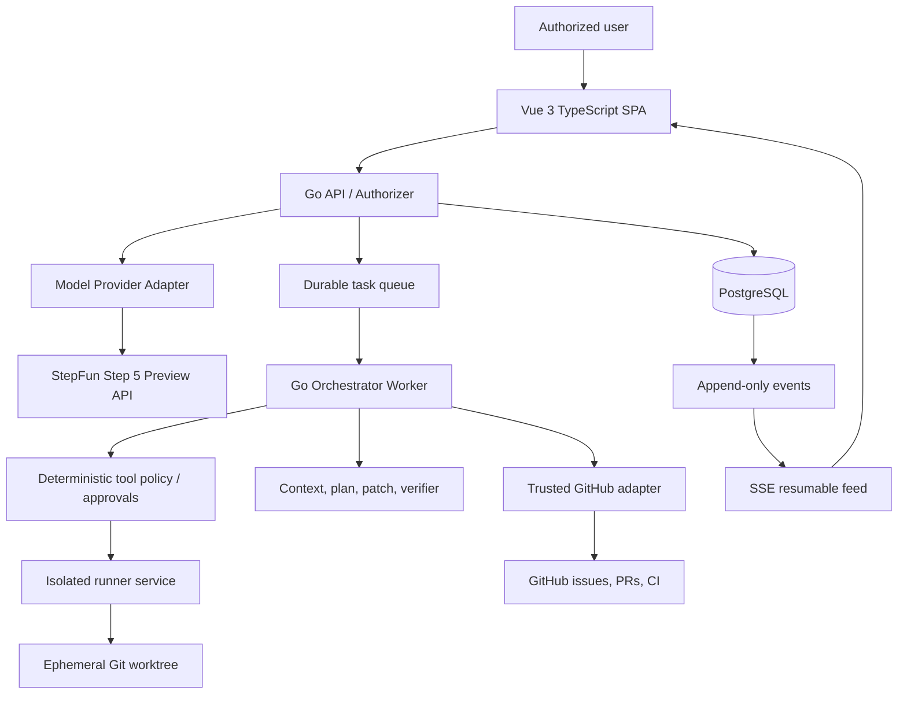

# RepoSurgeon — Technical Architecture and Trust Boundaries

## Application context

## Non-negotiable trust boundaries

1. **Browser to API:** browser is untrusted. Validate authentication, org/project ownership, idempotency and object-specific permissions on every endpoint.
2. **Model to tooling:** model outputs/tool args are untrusted data. Validate JSON Schema, path scope, action allowlist, explicit approval and budget in deterministic Go code.
3. **Source workspace to host:** cloned code, package hooks and test programs are hostile by default. Run in isolated non-root resources with no host credential mounts/socket, restrict disk/resource/network and destroy after use.
4. **Executor to GitHub:** executor does not get GitHub App private key or installation token. Only trusted GitHub adapter receives short-lived token and handles push/PR/merge.
5. **API to StepFun:** only authorized/redacted content crosses the provider boundary; protect StepFun key, log model request metadata rather than raw secrets.
6. **Audit/metrics:** never mistake emitted model text for a verified tool result; only deterministic execution and GitHub status are authoritative.

## Canonical Go module boundaries

`cmd/api` wires HTTP; `cmd/worker` wires leases/state machine; `cmd/runner` may be a separate unprivileged service; `internal/domain` defines types; `internal/store` owns transactions; `internal/auth` and `internal/policy` enforce identity and scope; `internal/model` has provider adapters; `internal/github` has GitHub App integration; `internal/gitworkspace` owns pinned checkout and cleanup; `internal/agent` owns state transitions/planning/verification; `internal/tools` owns tool registry/schemas; `internal/runnerclient` binds the isolated executor; `internal/evaluation` holds fixture scorers; `internal/telemetry` normalizes events and metrics. Keep circular dependencies out.

## Persistence baseline

`organizations(id,slug,...)`; `users(id,...)`; `memberships(user_id,org_id,role,...)`; `projects(id,org_id,...)`; `repository_connections(id,project_id,github_installation_id,repo_id,...)`; `issues(id,repo_id,external_id,body_hash,...)`; `tasks(id,issue_id,...)`; `runs(id,task_id,model_config_id,base_sha,state,budget,...)`; `run_steps(id,run_id,type,status,attempt,...)`; `tool_calls(id,run_step_id,effect_id,arguments_hash,result_ref,...)`; `plans(id,run_id,revision,schema_json,...)`; `patches(id,run_id,checkpoint_id,...)`; `checks(id,run_id,command,exit_code,...)`; `approvals(id,run_id,actor,action,decision,expires_at,...)`; `model_usage(id,run_id,provider,model,prompt_tokens,cached_tokens,output_tokens,usd_cost,...)`; `pull_requests(id,run_id,number,url,merge_sha,...)`; `audit_events(id,org_id,run_id,sequence,...)`. These are design seeds, not substitutes for typed migrations.

All multi-tenant records require scoped indexes and authorization. Use UTC timestamps and cryptographically strong opaque IDs. Never store secrets in run/event bodies.

## Durable job execution model

Poll with PostgreSQL `FOR UPDATE SKIP LOCKED`, lease and heartbeat. Acquire per-workspace mutation lock. Record state/effect receipt before/after effects. On restart reconcile observed external state (file hash, git branch, GitHub PR number) rather than blindly replaying mutation. Bound max runtime, output, step count, token spend and cost; cancel frees runner resources. Persist events then publish to SSE; late clients replay by cursor.

## Tool execution taxonomy

- Read-only: `repo_tree`, `search_code`, `read_file`, `git_status`, `inspect_tests`, `inspect_diff`.
- Working tree mutation (policy-gated): `apply_patch`, `restore_checkpoint`, `format_files`.
- Isolated test commands (sandbox-gated): `run_check` with verified command profiles; never raw host `bash -c` from model.
- External GitHub mutation (elevated): `push_branch`, `open_pr`, `merge_pr`, `delete_merged_branch` via trusted service and explicit policy.
- Human decision: `request_approval` records a permission request; cannot self-approve.

Every tool requires typed arguments, bounded response, correlation/effect IDs, risk class and receipt. Any unsupported tool call returns typed `unsupported_tool` error.

## UX and appearance

Use premium minimal light theme, off-white backgrounds, navy `#0A1F44` headings, gray `#E5E7EB` dividers, restrained gold `#C9A227` for rare highlights. Display actual state and errors, no stock metrics. Each critical action has auditability and a way to view exact relevant evidence.

## API and event contracts

See `API_CONTRACTS.md` for examples. Contract-first OpenAPI governs server/client drift; stream events via SSE only as presentation channel, not a replacement for persisted source of truth.
